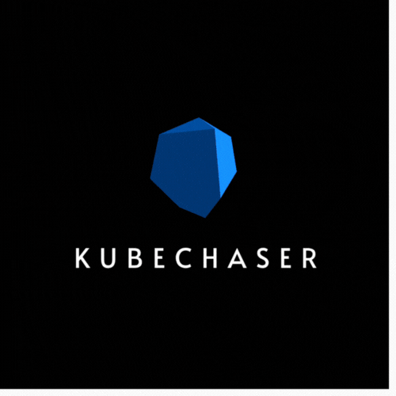

<p align="center">
  
</p>

[**KubeChaser**](https://kubechaser.dev) is a 3D renderer for visualizing Kubernetes clusters.

⚠️ **Note**  
> This project is under active development.

## Install
You will need `cmake`  and to install run 
```
git clone --recurse-submodules https://github.com/kabicin/kubechaser.git; cd kubechaser; ./scripts/build_and_run.sh
```

## Dependencies
- Eigen
- GLFW
- GLAD
- STB
- GLM
- Dear ImGUI

## Development

Build the desktop application and tests:

```sh
cmake -S . -B build
cmake --build build --parallel
```

Run the tests:

```sh
./scripts/test.sh
```

This uses an incremental core-only build. To build the desktop application as
well before running the tests, use `./scripts/test.sh --full`.

The full build adds tests for the application code:

- `camera_test`, `entity_test` and `scene_test` cover the camera, entities
  (IDs, transforms, textures, picking, OBJ loading, GPU resource cleanup) and
  scene logic (`SceneDocument`, `SceneNode`, `Scene`, `SceneManager`). They run
  without a GPU: `tests/support/TestSupport.h` replaces the GL functions they
  touch with recording stubs.
- `renderer_test` opens a hidden OpenGL 4.1 window, checks that every
  generated shader variant links, and draws entities and scenes offscreen,
  checking the resulting pixels. CTest reports it as skipped when no GL
  context is available; set `KUBECHASER_REQUIRE_GL=1` to make that a failure.
  On a headless Linux machine, run it under `xvfb-run` with Mesa.

GitHub Actions (`.github/workflows/ci.yml`) builds the core library on Linux and
the full application on Linux (Mesa under Xvfb, renderer test required) and on
macOS, and runs the tests on every push to `main` and on every pull request.

Shaders are generated and compiled in memory. To inspect the generated GLSL,
set `KUBECHASER_SHADER_DUMP_DIR` to a writable directory before launching the
app; each generated shader is written there as `mutable_shader_<n>.<stage>`.

The platform-independent core and its tests can be built without OpenGL or the
desktop application:

```sh
cmake -S . -B build-core -DKUBECHASER_BUILD_APP=OFF
cmake --build build-core --parallel
ctest --test-dir build-core --output-on-failure
```
